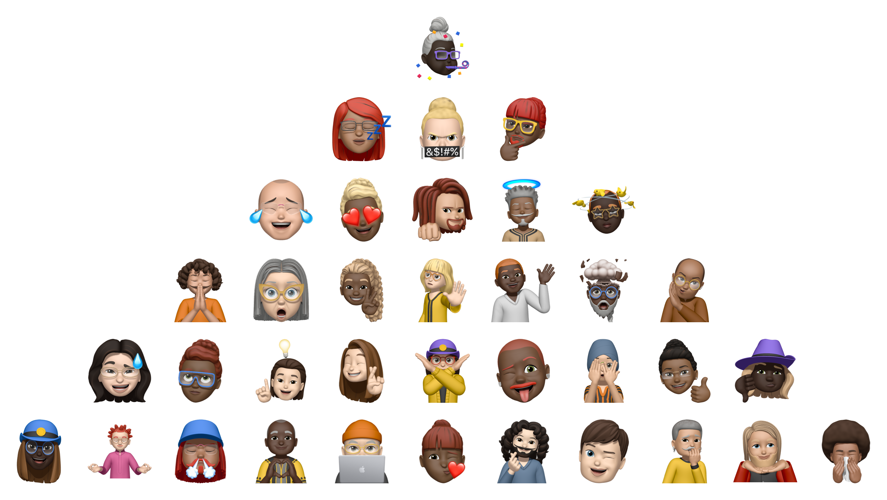

# avatarize

A command-line tool for building Memoji-style avatars on a Mac and rendering them as stickers: thumbs up, waving, mind blown, a yearbook portrait and 65 more poses.

<p align="center">
  
</p>

```sh
avatarize new alex.json hair=curly_long_upDo_fringe hair.color=Auburn eyewear=rectangle
avatarize render alex.json --pose thumbs_up --pose person_waving --out renders/
```

Each render is a square, transparent PNG trimmed to the avatar and centered, so heads, hair and props are never clipped.

The tool calls no AI service and needs no API key. It is built so that you, or an AI agent such as Claude Code, can find every valid value from the CLI itself. To turn a photo into an avatar, an agent looks at the photo and runs the commands. See [AGENTS.md](AGENTS.md) and the skill in `.claude/skills/avatarize/`.

> **Unofficial and unsupported.** This project is not affiliated with or endorsed by Apple. Memoji is a trademark of Apple Inc.
>
> Rendering uses `AvatarKit`, a *private* macOS framework, through the Objective-C runtime. It can break with any macOS update. This repo contains no Apple assets or data: every feature, color and pose is read at runtime from the Mac it runs on.

## Requirements

- A recent macOS with Xcode command line tools (`xcode-select --install`). It was built and tested on macOS 27.
- Python 3.10+ and [uv](https://docs.astral.sh/uv/)

## Usage

```sh
uv sync
uv run avatarize guide     # the whole workflow on one screen
```

### 1. Discover

```sh
avatarize options                 # categories: hair, head, eyes, eyewear, outfit, ...
avatarize options hair            # every hair style and color, with descriptions
avatarize poses                   # every pose
avatarize poses --search wave
```

Add `--json` for machine-readable output.

### 2. Build

```sh
avatarize new alex.json
avatarize set alex.json head.color="Light Fair Skin Tone 2" head.shade=0.2
avatarize set alex.json hair=curly_long_upDo_fringe hair.color=auburn hair.shade=0.3 eyes.color=Green
avatarize show alex.json
avatarize check alex.json         # exit 1 if AvatarKit would ignore any value
```

| key | sets | example |
| --- | --- | --- |
| `<category>=<preset>` | the shape or style | `eyewear=rectangle` |
| `<category>.color=<name>` | the main color (also `.color2`, `.color3`) | `hair.color=Auburn` |
| `<category>.shade=<-1..1>` | darker or lighter version of the main color | `head.shade=-0.4` |

`head.color` is the skin tone. A value can be an id or a description from `options`, in any letter case. Bad values fail with suggestions:

```
$ avatarize set alex.json hair=curly_long
error: 'curly_long' is not a valid hair preset. Did you mean: curly_long_up_bun, curly_long_mid_upDo, ...
```

### 3. Render

```sh
avatarize render alex.json                                   # default pose -> alex-pleasant_neutral.png
avatarize render alex.json --pose thumbs_up -o thumbs.png
avatarize render alex.json --all-poses --out renders/ --size 1024
avatarize sheet renders/                                     # HTML page of every PNG
```

`render` also takes `--margin` (empty border as a fraction of the size, default 0.04).

## Making an avatar from a photo with an AI agent

Open Claude Code (or another coding agent) in this folder and ask, for example:

> Make an avatar for photos/alex.jpg and render it waving and giving a thumbs up.

The agent reads the photo, runs `avatarize options` to see what is available, and builds the avatar with `set`. It then renders and compares the result with the photo, and adjusts until it matches. For a whole event, ask it to do the same for each photo and finish with `avatarize sheet`.

Only use photos of people who have agreed to it, and get a parent's or guardian's consent for minors.

## How it works

A Memoji is a small JSON descriptor. It picks a preset for each feature and a named color with a shade for each colorable part. `avatarize/native/avtbridge.m` is a small Objective-C helper, compiled on first use. It asks AvatarKit for the catalog of features and poses, checks descriptors, and renders stickers with clipping correction. It then crops each image to its visible pixels and centers it on a square canvas.

## Development

```sh
uv run pytest                                     # macOS only
uv run ruff check . && uv run ruff format --check .
uv run --with pillow scripts/readme_gallery.py    # regenerate docs/gallery.png (--seed N for a new mix)
```

CI (`.github/workflows/ci.yml`) has two jobs:

- **Lint:** runs on Linux.
- **Tests:** runs on a macOS runner. It also renders sample poses and uploads them as a build artifact.

## License

MIT
